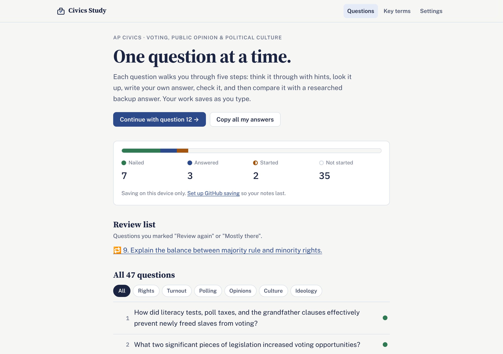
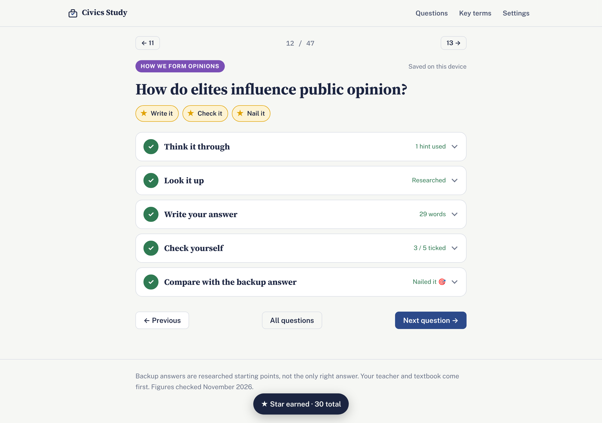

# Civics Study

[](https://github.com/stphnwlsh/civics-study/actions/workflows/deploy.yml)
[](https://astro.build)
[](LICENSE.md)

My daughter came home with a list of 47 questions for her 8th grade AP social studies class: voting rights,
turnout, polling, public opinion and political culture. A stapled worksheet would have done the job, but
where's the fun in that?

So instead it's a study site that takes her through the list **one question at a time**. She works out her
own answer first, with hints and research tools to help, and only then compares it with a researched backup
answer. The point was to show her that tech can be fun, look good, and actually help with school.

**Live site:** https://stphnwlsh.github.io/civics-study/ (password protected, because it's hers)



## How a question works

Every question is the same five steps, in the same order, so the habit sticks:

| Step | What happens |
|---|---|
| **1. Think it through** | Hints unlock one at a time, from a gentle nudge to a strong pointer. Key terms are listed as tappable chips with short definitions, as a reminder to use the vocabulary. |
| **2. Look it up** | A search box, pre-filled with good search phrases, that opens results in Google, Britannica, Wikipedia, Khan Academy, the National Archives, the Library of Congress, Oyez, Pew Research or the Census Bureau. |
| **3. Write your answer** | Her answer plus a separate scratchpad for research notes, with a word count. Saves as she types. |
| **4. Check yourself** | A checklist of what a complete answer usually covers, to tick off before peeking. |
| **5. Compare** | The backup answer with its sources. Trying to reveal it before writing anything gets a polite "try a sentence or two first". She then rates herself: *Nailed it*, *Mostly there* or *Review again*. |



### The game part

Kept light on purpose, so it feels like a nudge and not a slot machine:

- **Steps are cards** that collapse as she finishes them and tick themselves off, so a question never feels like one long page.
- **Three stars per question:** *Write it* (20+ words), *Check it* (most of the self-check ticked) and *Nail it* (rated herself "Nailed it").
- **Ranks** climb the ladder of civic life as stars add up, from Registered Voter through Poll Worker, City Council Member and U.S. Senator to Supreme Court Justice.
- **Unit stickers** in the spirit of an "I Voted" sticker, one for each of the six units, earned by answering every question in it.
- A **study streak**, and a small burst of confetti for "Nailed it" and promotions (skipped for anyone who prefers reduced motion).

The home page tracks progress, picks up where she left off, keeps a review list of anything marked
*Review again* or *Mostly there*, and can copy every answer as plain text to paste into a document. There's
also an A–Z page of every key term across all 47 questions.

### The final quiz

When the studying is done, the **Quiz** tab is the dress rehearsal. Each round pulls 20 multiple-choice
questions from a pool of 120+, three or four from every unit, and tries not to repeat the last round. She
finds out right away whether each answer was right, with a one-line explanation either way.

A round ends with a medal:

| Score | Level | Medal |
| --- | --- | --- |
| 18–20 | ⚖️ Supreme Court | Platinum |
| 15–17 | 🦅 Senate | Gold |
| 12–14 | ⭐ Governor | Silver |
| 9–11 | 🏛️ City Council | Bronze |

Every question is tagged with its unit and the study question it came from, so the results break down
by topic and link straight back to the questions worth another look. Every round is kept, so the Quiz tab
also shows a chart of her scores over time, her best, and which unit has been weakest over the last
five rounds. She can take it as many times as she likes, and a half-finished round picks up where she
stopped.

## The backup answers

Each one is written at a strong 8th grade reading level and tries hard to be neutral on anything political,
religious or culture-war shaped: describing what each side believes, not picking one. Where a question asks
for numbers, they come from the newest data available:

- **Turnout** from the U.S. Census Bureau's survey of the 2024 election and the University of Florida Election Lab
- **How groups voted in 2024** from Pew Research Center's validated-voter study and Rutgers' Center for American Women and Politics
- **History and law** from the National Archives, the Department of Justice, the Constitution Annotated and Oyez

Every answer lists its sources, and every fact was checked in November 2026. They're a solid starting point,
not the only right answer. The teacher and the textbook still win.

## Where her notes go

Answers save to the browser instantly, so nothing is lost if the Wi-Fi drops. They also save to a **private**
GitHub repo, one Markdown file per question (`notes/q01.md` … `notes/q47.md`), so her work survives a cleared
browser and follows her to another computer. It also means her notes are plain files she can read
on github.com, long after the test. Quiz rounds go in the same repo as `quiz/results.md`: a table of every
round that reads nicely on GitHub (handy for a parent checking in), with the data the site needs tucked
in at the bottom.

Setting that up on a device:

1. Create a private repo for the notes (this one uses `civics-study-notes`).
2. Make a [fine-grained personal access token](https://github.com/settings/personal-access-tokens/new) with
   **Repository access → Only select repositories →** the notes repo, and **Permissions → Contents → Read and write**.
   Nothing else.
3. On the site, open **Settings**, paste the token, and press **Save and test**.

The token lives only in that browser and is only ever sent to `api.github.com`. Because it can touch nothing
but the notes repo, the worst a lost token can do is edit study notes. Settings also has a download/upload
backup file for good measure.

## The password

GitHub Pages can't ask for a login, so the build does it instead. After `astro build`,
[`scripts/encrypt.mjs`](scripts/encrypt.mjs) encrypts every page with AES-256-GCM, using a key derived
(PBKDF2-SHA256, 600,000 rounds) from a password stored as the repository secret `SITE_PASSWORD`. Each page
is replaced by a small unlock screen. The right password decrypts it in the browser, and the derived key is
remembered on that device so she only types it once.

Two honest caveats:

- This repo is public, so the questions and backup answers can be read right here on GitHub. The password keeps
  the *site* private, which is what matters for her notes setup and for keeping it hers.
- Changing the password means updating the secret and re-running the deploy. Old remembered keys stop working
  and the site simply asks again.

## Tech

- [Astro](https://astro.build), building 50 static pages: the home page, one per question, the key-terms page and settings
- Plain TypeScript in the browser, no UI framework
- No backend at all. GitHub Pages serves the files, the GitHub REST API stores the notes
- Light and dark themes that follow the system setting
- Works on a phone, and the arrow keys move between questions on a keyboard

All the content lives in one file, [`src/data/questions.js`](src/data/questions.js). Each question has its
hints, key terms, search phrases, self-check points, backup answer and sources. Edit it there to fix a fact
or add a question; everything else is generated from it.

## Running it locally

Needs Node 22.23 or newer.

```sh
npm install
npm run dev
```

Then open http://localhost:4321/civics-study/. Without `SITE_PASSWORD` set, the build skips encryption,
which keeps local work simple. To try the password screen locally:

```sh
SITE_PASSWORD=something npm run build
npm run preview
```

## Deployment

Every push to `main` runs [the Deploy workflow](.github/workflows/deploy.yml): install, type-check, build,
encrypt, publish. One-time setup:

1. **Settings → Pages → Source:** *GitHub Actions*
2. **Settings → Secrets and variables → Actions → New repository secret:** `SITE_PASSWORD`

If the secret is missing the workflow stops before publishing, rather than putting an unlocked copy online.

## License

[MIT](LICENSE.md). If you've got a kid with a question list of their own, help yourself.
